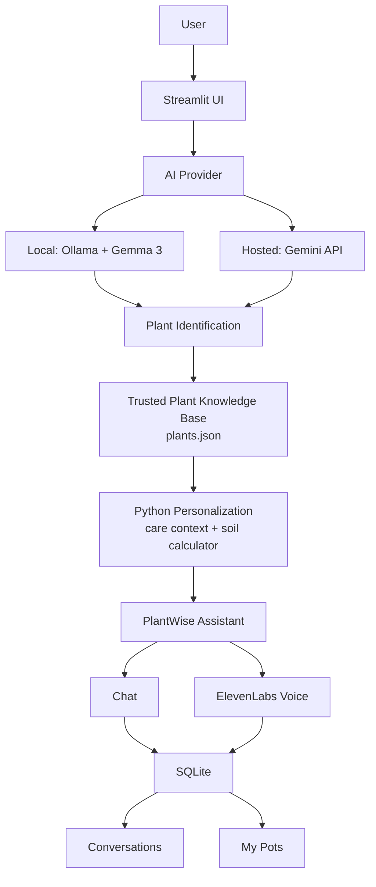
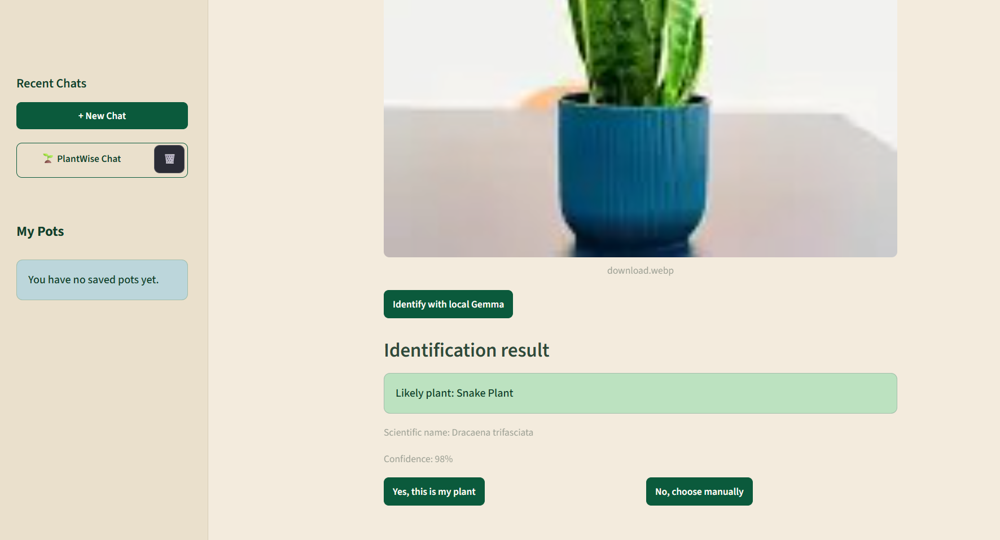
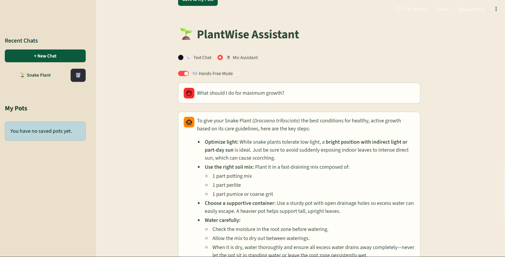
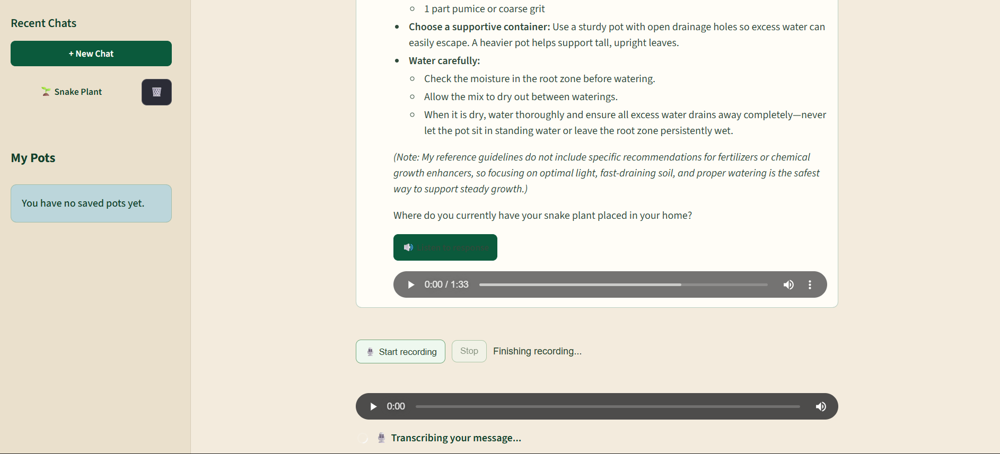

# PotWise

**Not sure what your plant needs? Just ask PotWise.**

PotWise is an AI-powered plant-care assistant built for Hacktoberfest 2026. Upload a plant photo, confirm the identification, and get grounded care guidance through chat or voice.

## Overview

PotWise combines multimodal AI with a trusted plant knowledge base and small, explicit Python calculations. An AI model helps identify the plant and understand the user's question, while the application remains responsible for trusted plant matching, care context, soil calculations, conversation persistence, and saved pots.

The result is a plant-care companion that is useful for everyday questions without treating a language model as the sole source of horticultural facts.

## Why PotWise?

Many plant owners can see that something is wrong but do not know whether the next step is to check light, moisture, drainage, soil, or the plant's recent environment. Care advice is also often needed while someone's hands are busy watering, repotting, or inspecting a plant.

PotWise turns a plant photo and a natural-language question into a practical, cautious conversation. Text chat is available when the user is at a desk, and microphone plus spoken responses support hands-busy gardening.

## Features

- AI plant identification from uploaded images
- User confirmation and manual correction of identified plants
- Trusted knowledge base covering 15 supported plants
- Season-aware and context-aware care guidance
- Plant-specific soil mix calculator based on pot volume and stored soil ratios
- PlantWise conversational assistant for plant problems
- Grounded follow-up questions and cautious possible-cause language
- Speech-to-text microphone interaction
- ElevenLabs text-to-speech responses
- Hands-Free Mode for automatically spoken assistant responses
- Recent Chats with persistent conversation history
- My Pots for plants explicitly saved by the user
- Per-session SQLite storage for no-login user isolation
- Local AI development with Ollama and Gemma 3
- Hosted AI deployment with Gemini API
- Provider abstraction for local Ollama or hosted Gemini
- Streamlit web application

## How It Works

1. The user uploads a plant photo.
2. The configured AI provider analyzes the image. Local development uses Ollama and Gemma 3; hosted deployments can use Gemini.
3. The model returns structured identification fields. It does not assign the application's plant ID.
4. PotWise matches the proposed name or candidates against the trusted records in `data/plants.json`.
5. The user confirms the plant or chooses a supported plant manually.
6. Python logic combines the trusted plant record, diagnostic data, season/context rules, and the selected pot volume to personalize the available guidance and soil quantities.
7. The PlantWise Assistant uses the trusted context to answer questions, ask follow-ups, and describe possible causes cautiously.
8. Text responses can be sent to ElevenLabs for speech. Microphone input follows the reverse path: speech recognition → assistant → spoken response.
9. Conversations/messages and explicitly saved pots are stored in the current session's SQLite database.

## Architecture



## AI Approach

PotWise deliberately separates model reasoning from trusted plant facts:

- Gemma or Gemini proposes an identity and understands the user's natural-language question.
- `data/plants.json` remains the trusted source for supported plant identity and care facts.
- `data/plant_problem_diagnostics.json` supplies structured problem and safety context.
- Python matches model candidates to trusted plant records and performs soil-mix calculations.
- The assistant receives the relevant trusted context and is instructed to use cautious language such as “possible cause” and “could be related.”

This keeps the assistant conversational without presenting an unverified model response as a definitive diagnosis.

## Voice Assistant

The voice flow is:

```text
User speech
    ↓
Speech recognition
    ↓
Grounded PlantWise Assistant
    ↓
ElevenLabs text-to-speech
    ↓
Spoken response
```

Text Chat remains available alongside Mic Assistant. Hands-Free Mode automatically requests speech for new assistant responses after the user enables it; browser autoplay restrictions may still require the manual audio fallback.

## Data & Privacy

PotWise does not require login. In Streamlit, each browser session receives an anonymous session ID and a separate SQLite file under `database/sessions/`. This prevents one active session from reading another session's conversations, messages, or saved pots.

The session database files are runtime data and are ignored by Git. The default `database/potwise.sqlite3` path remains available for local library/test usage, while the Streamlit application passes its session-specific path explicitly.

API keys must be provided through local environment/secrets configuration and are never intended to be committed to the repository.

## Tech Stack

| Area | Technology |
| --- | --- |
| Language | Python |
| Web application | Streamlit |
| Local vision/chat model | Ollama + Gemma 3 |
| Hosted vision/chat model | Gemini API via `google-genai` |
| Voice | ElevenLabs speech-to-text and text-to-speech |
| Persistence | SQLite |
| Trusted data | JSON |
| Collaboration | Git and GitHub |

## Project Structure

```text
PotWise/
├── app.py
├── requirements.txt
├── core/
│   ├── ai_provider.py
│   ├── assistant.py
│   ├── chat_history.py
│   ├── identify.py
│   ├── mic_recorder.py
│   ├── plant_data.py
│   ├── pots.py
│   ├── problem_data.py
│   ├── problem_matcher.py
│   ├── soil.py
│   ├── voice.py
│   └── watering.py
├── components/
│   └── mic_recorder/
│       └── index.html
├── data/
│   ├── climates.json
│   ├── plant_problem_diagnostics.json
│   ├── plants.json
│   ├── plants_15_source_backed.json
│   └── validate_data.py
├── database/
│   ├── db.py
│   └── sessions/              # Runtime, per-Streamlit-session SQLite files
├── research/
│   ├── plants_15_research_notes.md
│   └── potwise_plant_problem_research_notes_v0.1.md
└── tests/
    ├── test_ai_provider.py
    ├── test_chat_history.py
    ├── test_database.py
    ├── test_identify.py
    ├── test_plant_data.py
    ├── test_pots.py
    ├── test_problem_data.py
    ├── test_session_isolation.py
    └── test_soil.py
```

## Running Locally

### 1. Clone the repository

```bash
git clone https://github.com/ritika-sharma013/PotWise.git
cd PotWise
```

### 2. Create and activate a virtual environment

Windows PowerShell:

```powershell
python -m venv .venv
.\.venv\Scripts\Activate.ps1
```

macOS/Linux:

```bash
python3 -m venv .venv
source .venv/bin/activate
```

### 3. Install dependencies

```bash
python -m pip install -r requirements.txt
```

### 4. Start Ollama and make Gemma 3 available

Install Ollama, start the local service, and pull the model:

```bash
ollama serve
ollama pull gemma3
```

The local provider uses Ollama at `http://127.0.0.1:11434` and defaults to the `gemma3` model.

### 5. Configure providers and secrets

For local development, the default provider is Ollama. You can make it explicit with an environment variable or Streamlit secret:

```text
AI_PROVIDER=ollama
```

For hosted Gemini use, configure `.streamlit/secrets.toml` locally or Streamlit Community Cloud secrets with:

```toml
AI_PROVIDER = "gemini"
GEMINI_API_KEY = "your-key-here"
GEMINI_MODEL = "gemini-3.8-flash"
```

Do not commit secrets. `.streamlit/secrets.toml` is ignored by Git.

ElevenLabs voice features additionally use `ELEVENLABS_API_KEY` and `ELEVENLABS_VOICE_ID` through the existing local environment configuration.

### 6. Run Streamlit

```bash
streamlit run app.py
```

## Deployment

PotWise is intended for deployment with Streamlit Community Cloud. Configure the hosted app's secrets with `AI_PROVIDER = "gemini"` and a valid `GEMINI_API_KEY`. The Gemini provider uses the same provider-level identification and assistant contracts as the local Ollama path, so the Streamlit UI and trusted-data flow remain the same.

## Future Improvements

- Add optional authenticated accounts for durable cross-device history.
- Move session SQLite storage to a managed database for production-scale deployments.
- Expand the trusted plant and diagnostic datasets with more regional guidance.
- Add deployment observability and provider health checks.
- Improve accessibility and automated browser-level UI coverage.

## Demo

[Live Demo](PASTE-LIVE-URL-HERE)

## Screenshots

### PotWise Home


### PlantWise Identification


### PlantWise Assitant


### User Query - text to speech



## Author

Created by [Ritika Sharma](https://github.com/ritika-sharma013) (`Rwitzeeka`).
